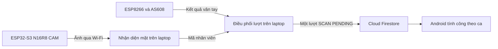

# Kế hoạch bổ sung chấm công khuôn mặt bằng ESP32-CAM

Ngày lập: 10/10/2026.

Cập nhật phần cứng 11/10/2026: người dùng đã mua **ESP32-S3-WROOM-1 N16R8 CAM hai cổng Type-C**, chưa nạp hoặc thao tác phần cứng. Sản phẩm ghi OV2640 nhưng chữ trên cáp được báo là OV5640; firmware tự dò cảm biến và công bố PID. Cấu hình S3 N16R8 có flash QIO 16MB, PSRAM OPI 8MB và pinout riêng dựa trên họ board thông dụng; cần xác minh PCB/cảm biến bằng log và ảnh thật. Hướng dẫn hiện tại tại [firmware camera](../../../firmware/esp32_cam/README.md); hướng dẫn AI Thinker/Downloader trước đây không áp dụng cho board S3 này.

Mục tiêu là demo chấm công cho 3–4 người bằng **vân tay hoặc khuôn mặt**. Laptop nhận diện ảnh từ ESP32-CAM và tiếp nhận kết quả vân tay từ ESP8266. Hai phương thức cùng xác định một người tại cùng điểm chấm công trong khoảng chống trùng chỉ tạo **một lượt chấm công gốc**. Android tiếp tục phân giải lượt quét theo lịch và ca như hiện tại.

Đã chuẩn bị code dịch vụ laptop, firmware camera, nhánh gateway cho ESP8266, trường dữ liệu và nhãn phương thức trên Android, cùng Firestore Rules. Có mô phỏng chạy khi chưa có camera; gateway ESP8266 mặc định OFF. Hướng dẫn chạy nằm tại [dịch vụ chấm công](../../../services/face_attendance/README.md). Đã có board S3; các bước xác minh camera thật, đăng ký 3–4 người, nạp board và triển khai Firebase vẫn chờ thử phần cứng và dữ liệu demo.

## Phạm vi demo và thiết bị

- Một điểm chấm công, 3–4 hồ sơ nhân viên; mỗi lần camera xử lý một người trong khung hình.
- ESP8266 và AS608/R307 tiếp tục nhận diện vân tay trong cảm biến.
- Board đang có: ESP32-S3-WROOM-1 N16R8 CAM hai Type-C, không cần Downloader rời. ESP32-CAM AI Thinker/Downloader là phương án cũ còn được firmware hỗ trợ riêng. Xác minh camera và PSRAM thực tế sau khi nạp đúng profile S3.
- Laptop chạy dịch vụ xử lý ảnh và điều phối lượt chấm công. ESP8266, ESP32-CAM và laptop cùng mạng Wi-Fi cho demo; hai board không cần nối UART với nhau.
- Laptop phải chạy để xử lý lượt mới trong chế độ tích hợp. Khi mất kết nối, thiết bị giữ dữ liệu vân tay chờ gửi và hiển thị trạng thái chờ; khuôn mặt chưa xử lý được khi laptop dừng.
- Chức năng mở cửa ngoại tuyến bằng mẫu AS608 hiện có là chính sách riêng, không đồng nghĩa lượt đã đồng bộ. Khi thay đường gửi dữ liệu, bảo toàn chính sách đó và thời hạn phản hồi của firmware.

## Kiến trúc dự kiến

Dịch vụ laptop dự kiến dùng Python và OpenCV, với YuNet để tìm khuôn mặt và SFace để đối chiếu danh tính. OpenCV có hướng dẫn chính thức cho hai bước này; lựa chọn phiên bản và ngưỡng nhận diện được chốt sau khi thử trên laptop và camera thật. Không dùng số liệu benchmark làm cam kết độ chính xác của demo. [Hướng dẫn OpenCV](https://docs.opencv.org/4.x/d0/dd4/tutorial_dnn_face.html)

ESP32-CAM chỉ cung cấp ảnh trong mạng demo. Laptop thực hiện nhận diện; Firebase lưu lượt chấm công và dữ liệu quản lý. Không đưa ảnh từng khung hình lên Firestore.

## Giai đoạn 1 Chuẩn bị môi trường và dữ liệu

1. Xác minh board ESP32-CAM, cảm biến ảnh, PSRAM, cáp USB truyền dữ liệu và nguồn cấp ổn định. Kiểm tra mạng cho phép các thiết bị liên lạc với laptop.
2. Ghi lại phiên bản firmware đang hoạt động, cấu hình chân camera thực tế và cách chạy dịch vụ laptop. Sao lưu firmware trước khi nạp thử; không xóa LittleFS khi còn lượt vân tay chờ gửi.
3. Chọn 3–4 nhân viên demo từ dữ liệu hiện có, gắn đúng mẫu vân tay và hồ sơ mặt với cùng `employeeId`. Không chuyển chủ mã mẫu vân tay khi còn dữ liệu chờ đồng bộ.
4. Chuẩn bị ca và lịch demo để app phân giải được lượt vào và ra. Dùng UTC khi lưu thời điểm và `Asia/Ho_Chi_Minh` khi hiển thị, theo dự án hiện tại.
5. Chuẩn bị thư mục dịch vụ, cấu hình mẫu và danh sách phụ thuộc. Dữ liệu ảnh, đặc trưng mặt, hàng đợi laptop và cấu hình bí mật nằm ngoài mã nguồn được theo dõi; bổ sung quy tắc bỏ qua tương ứng.

Điều kiện hoàn thành: có danh sách nhân viên demo, phần cứng được xác minh, mạng nội bộ hoạt động và dữ liệu vân tay hiện có được bảo toàn.

## Giai đoạn 2 Chạy camera riêng

1. Tạo firmware camera riêng tại `firmware/esp32_cam/`, không sửa luồng vân tay ở bước này.
2. Cho laptop lấy ảnh JPEG từ camera. Bắt đầu thử VGA 640×480; điều chỉnh độ phân giải và tần suất lấy ảnh theo độ rõ của mặt, nguồn và Wi-Fi thực tế.
3. Hiển thị ảnh trên laptop và kiểm tra khuôn mặt ở vị trí chấm dự kiến. Chưa tạo lượt chấm công trong Firebase.
4. Thử khởi động lại camera, mất rồi nối lại Wi-Fi và rút laptop khỏi phiên xem ảnh. Chỉ dẫn lỗi phải phân biệt mất camera và chưa phát hiện khuôn mặt.

Điều kiện hoàn thành: xem ảnh liên tục khoảng 10 phút tại điểm demo, không lặp khởi động lại hoặc lỗi lấy ảnh kéo dài; sau khi nối lại mạng có thể tiếp tục lấy ảnh.

## Giai đoạn 3 Đăng ký và nhận diện mặt cho 3 đến 4 người

1. Đăng ký hồ sơ mặt trên laptop bằng tài khoản quản trị. Mỗi hồ sơ liên kết với nhân viên đang hoạt động; hồ sơ mặt không sử dụng giả `templateId` vân tay.
2. Thu khoảng 10–15 mẫu rõ mặt cho mỗi người với một số góc nhìn và ánh sáng trong phạm vi demo. Đây là số mẫu khởi đầu để thử, không phải điều kiện bảo đảm nhận diện.
3. Kiểm tra chất lượng ảnh, căn chỉnh mặt và lưu đặc trưng nhận diện trên laptop. Giới hạn truy cập dữ liệu mẫu và cho phép quản trị đăng ký lại hoặc xóa hồ sơ.
4. Đối chiếu với toàn bộ 3–4 người, chỉ nhận một danh tính đủ chắc chắn. Người chưa đăng ký, ảnh mờ, kết quả sát nhau hoặc nhiều khuôn mặt trong khung không phát sinh lượt công.
5. Yêu cầu kết quả ổn định qua vài khung ảnh trước khi phát sự kiện. Sau khi phát một lượt, chờ người đó rời khung hình trước khi cho phép một phiên nhận diện mặt mới. Khi dịch vụ hoặc camera khởi động lại, khôi phục phiên hiện diện hoặc yêu cầu thấy khung trống từ ảnh mới trước khi cho chấm tiếp; mất luồng ảnh không được xem là người đã rời khung.
6. Thử nhận diện bằng các lần đứng trước camera mới, không dùng lại ảnh đã đăng ký làm bộ kiểm tra. Kiểm tra người chưa đăng ký bằng người thử khác hoặc tạm loại một hồ sơ khỏi danh sách nhận diện.

Điều kiện hoàn thành: mục tiêu demo là ít nhất 9/10 lần thử đúng cho từng người trong điều kiện đã chọn, không gán sai danh tính ở các ca thử âm tính. Nếu chưa đạt thì điều chỉnh ảnh, ánh sáng, vị trí và ngưỡng trước khi nối Firebase. Ghi lại kết quả thử ảnh in hoặc ảnh trên điện thoại để xác định giới hạn; chống giả mạo mạnh là phần nâng cấp riêng.

## Giai đoạn 4 Tạo đầu mối chấm công chung và chống trùng

Tạo dịch vụ tại `services/face_attendance/` để nhận sự kiện mặt và vân tay. Dịch vụ có hàng đợi lưu trên đĩa, kết quả xử lý theo mã sự kiện và trạng thái chấm đã lưu bền vững.

### Hai lớp kiểm tra trùng

- **Gửi lại cùng sự kiện:** giữ `sourceEventId` từ nguồn. Nếu đã xử lý, trả kết quả cũ cùng `attendanceId`; không tạo lượt mới. Cùng mã nhưng nội dung khác là xung đột cần xử lý rõ ràng.
- **Hai phương thức của cùng người:** dùng chung `employeeId` và điểm chấm công, đối chiếu thời điểm quét gốc với cửa sổ chống trùng. Khởi đầu giữ 180 giây như lớp tính công hiện có. Nhân viên khác được xử lý độc lập.

Kiểm tra và tạo lượt phải nằm trong cùng giao dịch Firestore: đọc trạng thái nhân viên, liên kết nguồn đang hoạt động, trạng thái chống trùng chung và biên nhận sự kiện, rồi ghi lượt và trạng thái nếu đủ điều kiện. Không chỉ kiểm tra hồ sơ bằng cache trước giao dịch, vì hồ sơ có thể vừa bị vô hiệu hóa. Hai request đồng thời phải cùng tranh chấp một trạng thái chung; không chỉ kiểm tra riêng rồi tạo hai tài liệu. Firestore hỗ trợ giao dịch và xử lý việc dữ liệu đọc bị thay đổi đồng thời. [Tài liệu giao dịch Firestore](https://firebase.google.com/docs/firestore/manage-data/transactions)

Lượt thứ hai được liên kết với lượt đã ghi nhận trong biên nhận nguồn. Bản ghi chấm công gốc giữ nguyên; không sửa lượt cũ để thêm phương thức thứ hai. Lượt trùng không kéo dài thời gian chống trùng và không khóa việc chấm của người khác.

### Thời điểm và dữ liệu đến muộn

- Lưu `capturedAt` của nguồn và `receivedAt` riêng. Không đổi giờ quét thành giờ gửi lại.
- Giữ lịch sử và kết quả xử lý trên đĩa/Firebase để khôi phục sau khi laptop khởi động lại; không chỉ nhớ lượt gần nhất trong RAM.
- Với lượt đến muộn, tìm các lượt của cùng người quanh thời điểm quét gốc và thực hiện kiểm tra dưới trạng thái chung. Không kết luận trùng chỉ dựa vào giờ laptop nhận request.
- Khi thiếu giờ tin cậy hoặc chưa đủ lịch sử để quyết định an toàn, giữ sự kiện chờ xử lý/xem lại; không tự biến thành lượt ra và không bỏ mất sự kiện.
- Không chia thời gian thành ô cố định để tạo ID chống trùng: hai tín hiệu gần nhau có thể nằm ở hai phía ranh giới ô.

### Phản hồi cho thiết bị

Phản hồi có `sourceEventId`, trạng thái và `attendanceId` khi đã có. Phân biệt đã đồng bộ, đã chấm trước đó, đã lưu trên laptop nhưng chờ đồng bộ, bị từ chối và chưa lưu được.

Chỉ xác nhận đồng bộ sau khi lượt chuẩn và biên nhận đã được lưu thành công. Sự kiện còn chờ trên laptop chưa làm ESP8266 xóa lượt khỏi hàng đợi. Lượt trùng đã được liên kết bền vững với lượt chuẩn có thể kết thúc retry, nhưng không phát lại còi hoặc mở cửa như một lượt mới. Không suy kết quả nghiệp vụ chỉ từ HTTP 2xx/409.

Điều kiện hoàn thành: các phép thử đồng thời, đảo thứ tự hai nguồn, mất phản hồi và khởi động lại đều tạo đúng một lượt chuẩn, có biên nhận giải thích từng sự kiện nguồn.

## Giai đoạn 5 Tích hợp firmware Firebase và Android

1. Thêm đường gửi vân tay về laptop tại `postAttendanceEvent()` và phần xả hàng đợi. Giữ cơ chế cấp mã sự kiện bền vững, lưu LittleFS trước khi gửi và xử lý từng bản ghi để phù hợp bộ nhớ ESP8266.
2. Để laptop xác minh liên kết vân tay hiện tại, hồ sơ mặt và trạng thái nhân viên; không tin `employeeId` tùy ý từ request. Khi tích hợp, lưu siêu dữ liệu hồ sơ mặt tại `faceProfiles/{employeeId}` gồm trạng thái và phiên bản hồ sơ; ảnh và đặc trưng vẫn ở laptop. Đọc lại nhân viên và liên kết nguồn trong giao dịch ghi lượt. Hai phương thức chỉ chấm khi nhân viên và hồ sơ tương ứng còn được phép sử dụng; phiên bản hồ sơ phải khớp kết quả nhận diện.
3. Dùng Firebase Admin SDK trên laptop làm đầu mối ghi lượt trong chế độ demo tích hợp. SDK này bỏ qua Firestore Rules, vì vậy kiểm tra danh tính nguồn, quyền quản trị và schema phải nằm trong dịch vụ; thông tin xác thực Admin chỉ đặt trên laptop. [Ranh giới Firestore Rules và thư viện server](https://firebase.google.com/docs/firestore/security/rules-conditions)
4. Định nghĩa biên nhận và trạng thái chống trùng chỉ dịch vụ được ghi. Không mở rộng quyền ghi trực tiếp cho ESP32-CAM hoặc ứng dụng nhân viên. Các Rules đọc lượt công và quản trị hiện có vẫn cần kiểm tra tương thích.
5. Mở rộng dữ liệu chấm công với phương thức `FINGERPRINT` hoặc `FACE`, định danh sự kiện nguồn và điểm chấm. Độ khớp vân tay và điểm tương đồng mặt có kiểu/ý nghĩa riêng, không dùng cùng một ngưỡng.
6. Tiếp tục ghi lượt gốc `SCAN/PENDING`, để Android phân giải vào/ra theo ca. Giữ lớp loại trùng 180 giây trong Android làm bảo vệ bổ sung; dữ liệu vân tay cũ không có trường phương thức vẫn đọc được.
7. Cho app hiển thị phương thức của lượt và trạng thái hồ sơ mặt. Đăng ký mặt thực hiện trên laptop trong bản demo đầu; màn hình đăng ký mặt đầy đủ trong Android có thể bổ sung sau khi luồng chấm ổn định.
8. Rà phản hồi LCD/LED/còi/servo: xác nhận đúng sự kiện hiện tại, báo đang chờ khi chưa đồng bộ, phản hồi muộn chỉ đồng bộ dữ liệu. Giữ lệnh đăng ký/xóa vân tay và heartbeat hiện có.
9. Chế độ tích hợp chỉ có một đầu mối ghi công. Không tự fallback sang ESP8266 ghi trực tiếp Firestore khi laptop mất kết nối, vì hai đường ghi sẽ phá điều kiện chỉ một lượt gốc. Chế độ vân tay cũ chỉ dùng khi chủ động chuyển toàn bộ điểm chấm về cấu hình cũ và dừng nhánh khuôn mặt.

Điều kiện hoàn thành: nhân viên chấm bằng một trong hai cách, thấy lượt đúng trên Android, tính công theo lịch/ca và không cần dùng cả hai cách. Các thao tác vân tay đang có tiếp tục hoạt động.

## Giai đoạn 6 Kiểm tra và chuẩn bị demo

| Tình huống | Kết quả cần đạt |
| --- | --- |
| Chỉ vân tay hoặc chỉ mặt | Một lượt SCAN/PENDING đúng nhân viên |
| Mặt rồi vân tay trong 180 giây | Một lượt công; nguồn thứ hai báo đã chấm |
| Vân tay rồi mặt trong 180 giây | Một lượt công; nguồn thứ hai báo đã chấm |
| Hai request đến đúng cùng lúc | Một lượt chuẩn, hai biên nhận nguồn |
| Hai tín hiệu gần nhau qua ranh giới phút | Vẫn chỉ một lượt, không phụ thuộc ô thời gian |
| Đứng trước camera lâu hơn 3 phút | Không sinh lượt mới từ phiên hiện diện đó |
| Khởi động lại khi người vẫn đứng trong khung | Không coi là phiên mới và không tạo lượt ra giả |
| Hai người chấm liên tiếp | Mỗi người được ghi một lượt độc lập |
| Người lạ, ảnh mờ hoặc nhiều mặt | Không tạo lượt công |
| Nhân viên/hồ sơ bị vô hiệu hóa | Từ chối phương thức không còn được phép |
| Hồ sơ bị vô hiệu hóa trong lúc ghi lượt | Giao dịch đọc lại trạng thái và từ chối lượt mới |
| Mất ACK rồi gửi lại cùng sourceEventId | Trả lại kết quả cũ, không tạo lượt mới |
| Laptop khởi động lại giữa xử lý | Khôi phục hàng đợi, biên nhận và trạng thái chống trùng |
| Mất Internet nhưng LAN còn hoạt động | Lưu chờ, không báo đã đồng bộ; lên mạng gửi đúng một lần |
| ESP8266 không kết nối được laptop | Giữ hàng đợi và thời điểm gốc, gửi lại khi kết nối được |
| Hai nguồn đến muộn sau mất mạng | Đối chiếu thời điểm gốc và lịch sử, không tính thành hai lượt |
| Biên nhận đến muộn hoặc là lượt trùng | Không phát lại còi/mở cửa theo sự kiện cũ |
| Lượt ra hợp lệ ở thời điểm sau | Được phân giải theo ca; không khóa cả ngày theo employeeId |

Khi triển khai, viết kiểm thử cho giao dịch đồng thời, retry sau mất ACK, khôi phục sau khởi động lại và dữ liệu đến muộn. Dùng Firestore Emulator cho kiểm thử tích hợp giao dịch; kiểm tra cấu hình và hành vi bằng tài liệu/SDK chính thức ở thời điểm triển khai.

Chạy kiểm thử firmware liên quan hàng đợi và runtime hiện có, kiểm thử Android về phân giải chấm công và đọc dữ liệu cũ/mới, rồi thử trên phần cứng thật. Kiểm thử mô phỏng không thay thế việc kiểm tra camera, nguồn và Wi-Fi.

Chuẩn bị hướng dẫn demo: bật thiết bị và laptop, mở dịch vụ, chọn hồ sơ/ca thử, xem trạng thái kết nối, chấm bằng từng phương thức và thử hai phương thức cùng lúc. Kịch bản thử liên tiếp trong vài giây phải dùng nhân viên khác hoặc môi trường thử tách biệt; không tắt chống trùng trên dữ liệu đang sử dụng.

## Các phần mã nguồn dự kiến thay đổi

| Vị trí | Công việc |
| --- | --- |
| `firmware/esp32_cam/` mới | Camera, Wi-Fi, lấy ảnh và phục hồi kết nối |
| `services/face_attendance/` mới | Nhận diện, đăng ký mẫu, API vân tay, hàng đợi và giao dịch chống trùng |
| `firmware/esp8266_fingerprint/30_attendance_storage.ino` | Đường gửi qua laptop, biên nhận có trạng thái, bảo toàn LittleFS và sourceEventId |
| `firmware/esp8266_fingerprint/40_attendance_service.ino` | Payload nguồn và phản hồi đúng lượt; giữ chính sách mở cửa hiện có |
| `app/src/main/java/vn/chamcong/iot/model/Models.kt` | Phương thức nhận diện, tương thích dữ liệu cũ |
| `app/src/main/java/vn/chamcong/iot/data/FirebaseRepositoryObservers.kt` | Đọc schema mở rộng |
| `app/src/main/java/vn/chamcong/iot/domain/AttendanceResolutionRules.kt` | Kiểm tra tương thích, giữ phân giải theo ca và bảo vệ trùng hiện có |
| `app/src/main/java/vn/chamcong/iot/ui/attendance/` | Nhãn phương thức và trạng thái lượt |
| `firebase/firestore.rules` | Quyền đọc và dữ liệu mới; không mở ghi tùy ý cho client |
| `.gitignore`, `README.md`, `firmware/VALIDATION.md` | Bỏ qua dữ liệu riêng, hướng dẫn chạy/demo và kết quả kiểm tra |

## Thứ tự triển khai

Làm xong camera riêng rồi nhận diện riêng cho 3–4 người. Sau đó thử đầu mối chống trùng bằng sự kiện mô phỏng trước khi đổi đường gửi vân tay. Cuối cùng nối Firebase/Android và chạy toàn bộ kịch bản demo. Mỗi giai đoạn có điều kiện hoàn thành để phát hiện lỗi ở đúng phần, không triển khai đồng loạt.

Các mốc thời gian chỉ chốt sau khi kiểm tra phần cứng và tốc độ nhận diện trên laptop thật. Bước triển khai đầu tiên là giai đoạn 1 và 2.
